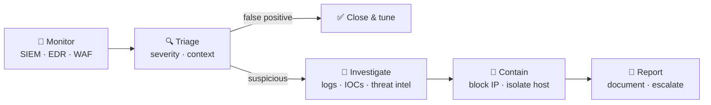

<a href="https://mosyaz.my">
  
</a>

<p align="center">
  <a href="https://mosyaz.my">
    
  </a>
</p>

<p align="center">
  <a href="https://mosyaz.my"></a>
  <a href="https://www.linkedin.com/in/syazwan-shukri/"></a>
  <a href="mailto:syazwanshkri1@gmail.com"></a>
</p>

---

### 👋 Hi, I'm Syazwan

I'm a **SOC Analyst at BitRanger Sdn. Bhd.** (CyRes, USM, Penang) through Khazanah Nasional's **K-Youth Development Programme**. I monitor, investigate and respond to security events, and I'm always learning more about threat detection and incident response.

```yaml
analyst:
  name: Mohamad Syazwan Mohd Shukri
  role: SOC Analyst @ BitRanger Sdn. Bhd.
  programme: K-Youth Development Programme, Khazanah Nasional
  location: Penang, Malaysia
  education: BIT (Hons.) Computer System Security, UniKL MIIT
  certs: [CompTIA Security+, MikroTik MTCNA]
  focus: [alert triage, incident investigation, threat hunting]
```

### 🎮 Try my interactive labs

| | Lab | What you do |
|---|---|---|
| 🚨 | [**Triage Lab**](https://mosyaz.my/#triage) | Classify 8 SOC alerts as true or false positives, with MITRE ATT&CK mapping |
| 🎣 | [**Phish Hunt**](https://mosyaz.my/#phishing) | Spot all 8 red flags in a phishing email |
| 💻 | [**Terminal**](https://mosyaz.my) | Type `help`, `nmap`, `whois`… (there are hidden commands too 👀) |

### 🔄 How I handle an alert



<details>
<summary><b>🧰 Toolkit</b> (click to expand)</summary>
<br>

| Area | Tools |
|---|---|
| **SIEM** | Stellar Cyber, RSA NetWitness |
| **Endpoint Security** | Bitdefender, Trend Micro Deep Security |
| **Firewalls & WAF** | Palo Alto, Huawei, Sangfor, FortiWeb WAF |
| **Networking & OS** | MikroTik RouterOS, Wireshark, Kali Linux, Windows |

<p>
  
</p>

</details>

<details>
<summary><b>💼 Experience</b> (click to expand)</summary>
<br>

- **SOC Analyst**, BitRanger Sdn. Bhd. · *Aug 2026 – Present*<br>
  K-Youth Development Programme, Khazanah Nasional · CyRes, USM, Penang
- **SOC Analyst (Intern)**, Heitech Padu Berhad · *Oct 2024 – Feb 2025*<br>
  SIEM alert triage, IOC-based threat hunting, firewall and WAF blocking
- **Telecommunication Drafter Engineer (Intern)**, ECHO Broadband Sdn. Bhd. · *Mar 2021 – Jul 2021*

</details>

<details>
<summary><b>📜 Certifications & Education</b> (click to expand)</summary>
<br>

- 🏅 **CompTIA Security+**: Dec 2023
- 🏅 **MikroTik Certified Network Associate (MTCNA)**: Dec 2020
- 🎓 **BIT (Hons.) Computer System Security**, UniKL MIIT · CGPA 3.50 · Dean's List ×4
- 🎓 **Diploma in Electronic Engineering (Data Transmission & Networking)**, MJII · CGPA 3.55

</details>

---

<p align="center">
  <sub>🛡️ <i>Every alert tells a story. Read the logs, trust the evidence.</i></sub>
</p>
